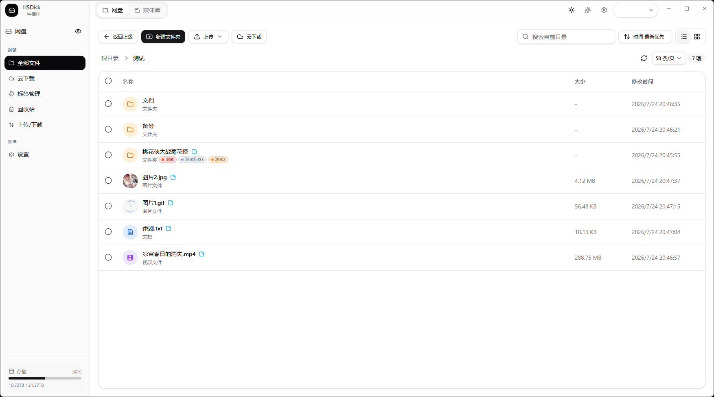

# 115Disk

一款强大、易用、贴心的 **115 网盘与媒体库管理**桌面客户端。
主打网盘管理与媒体库，让你更轻松的管理网盘视频。

面向 115 网盘改善网页版体验：在同一个桌面端完成网盘管理、上传下载、云下载、在线播放和媒体库整理——封面、元数据，一切都有。

## 功能亮点

- **完善网盘文件管理** — 浏览目录、多选操作与快速跳转，网页有的几乎都有，在桌面端高效管理 115 网盘文件。
- **强大的下载上传** — 多任务队列、并发控制、暂停与断点续传，支持文件夹递归下载，可拖拽上传文件或文件夹。
- **云下载 / 磁力** — 支持磁力链接确认与云下载任务，方便把资源保存到网盘。
- **在线视频播放** — 本地 HLS 代理播放，支持播放列表，流畅观看网盘中的视频内容。
- **出色的媒体库 · 海报墙** — 支持管理网盘中的电影、电视剧、动漫，甚至包括**~~老司机~~**，支持海报墙。

## 功能介绍

### 网盘与传输

- **文件管理**：目录浏览、多选、跳转，贴近桌面文件管理习惯
- **本地下载**：任务队列、并发控制、暂停 / 续传、文件夹递归下载
- **本地上传**：秒传、分片上传、断点续传，支持拖拽文件 / 文件夹
- **云下载**：磁力链接确认后创建云下载任务，资源直接落入网盘

### 播放与媒体库

- **在线播放**：通过本地 HLS 代理播放网盘视频，支持播放列表
- **媒体库**：按电影 / 剧集 / 通用（老司机）等类型归组展示
- **扫描与刮削**：自动扫描识别，补充封面与元数据，让资源库更易检索

### 体验与数据

- **本地优先**：会话、任务与设置保存在本机
- **应用更新**：可从 [GitHub Releases](https://github.com/leck995/115disk/releases) 获取新版本

## 获取与源码

| 项目 | 链接 |
| --- | --- |
| 仓库 | [https://github.com/leck995/115disk](https://github.com/leck995/115disk) |
| 发布页 | [https://github.com/leck995/115disk/releases](https://github.com/leck995/115disk/releases) |
| 问题反馈 | [Issues](https://github.com/leck995/115disk/issues) |

欢迎 Star、提交 Issue。

更多使用说明见文档站 [指南](./docs/guide/)。
