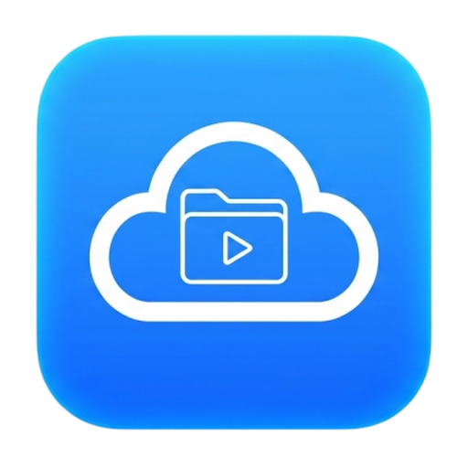
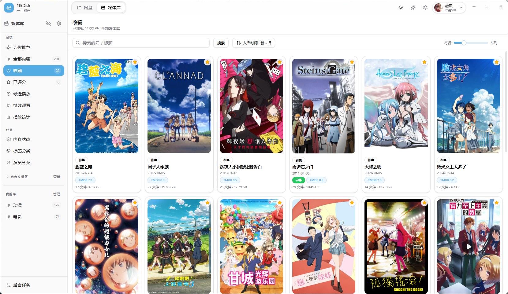

  

<h1 align="center">115Disk</h1>

  面向 <strong>115 网盘</strong> 的桌面客户端，集文件管理、传输、在线播放与媒体库于一体。

  <a href="https://115disk.999758.xyz/"><strong>在线文档</strong></a>
  &nbsp;&middot;&nbsp;
  <a href="https://github.com/leck995/115disk/releases"><strong>下载最新版</strong></a>
  &nbsp;&middot;&nbsp;
  <a href="https://github.com/leck995/115disk/issues"><strong>问题反馈</strong></a>

  网盘管理 &middot; 上传下载 &middot; 云下载 &middot; 在线播放 &middot; 媒体库

---

## 核心能力

| 场景 | 能力 |
| --- | --- |
| 文件管理 | 浏览目录、多选操作、快速跳转、列表和网格视图，以及按名称、大小或时间排序。 |
| 上传与下载 | 任务队列、并发控制、暂停与续传；支持文件夹递归下载与拖拽上传。 |
| 云下载 | 确认磁力链接后创建云下载任务，资源直接保存到网盘。 |
| 在线播放 | 通过本地 HLS 代理播放网盘视频，并支持播放列表。 |
| 媒体库 | 按电影、剧集和通用库整理内容，展示海报、详情与元数据。 |
| 扫描与刮削 | 扫描识别媒体文件，补充封面和元数据，方便检索与维护。 |

## 界面预览

<table>
  <tr>
    <td width="50%" align="center">
      
       
      网盘文件管理
    </td>
    <td width="50%" align="center">
      
       
      媒体库
    </td>
  </tr>
</table>

## 使用方式

| 目标 | 入口 |
| --- | --- |
| 查看完整使用说明 | [在线文档](https://115disk.999758.xyz/) |
| 阅读仓库内文档 | [使用指南](./docs/guide/) |
| 获取应用版本 | [GitHub Releases](https://github.com/leck995/115disk/releases) |
| 提交问题或功能建议 | [GitHub Issues](https://github.com/leck995/115disk/issues) |

## 本地优先

会话、任务和应用设置均保存在本机。网络代理、媒体库元数据服务与网盘请求相互隔离，便于按自己的网络环境配置。

---

欢迎 Star、提交 Issue，或通过 [在线文档](https://115disk.999758.xyz/) 了解更多功能。
